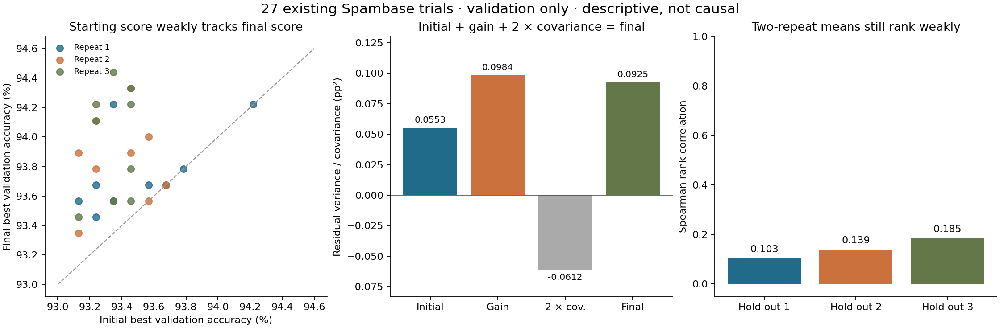

# Calibration noise diagnosis and proposed shared-start pilot

Completed offline on 2026-10-13 using the existing 27 Spambase trials.
**No new model request, sandbox job or final-test evaluation was made.**
The previous calibration verdict remains unchanged: stable configuration signal
was not demonstrated. This is a retrospective diagnosis, not a new experiment.

## Findings

| Check | Result | What it supports |
|---|---:|---|
| Searches exceeding their initial two drafts | 22 / 27 | Later search often improves the incumbent |
| Mean final minus initial accuracy | +0.4443 percentage points | Descriptive improvement within these validation searches |
| Initial versus final score Pearson correlation | 0.2161 | Starting score alone weakly tracks the final score |
| Rank correlation: two-repeat mean versus excluded repeat | 0.1030 / 0.1387 / 0.1849 | Averaging two repeats still gives weak agreement with another repeat |
| Median of those three correlations | 0.1387 | No demonstrated ranking remedy from this small averaging check |

The excluded repeat is **another run on the same validation split**, not an unseen
test dataset. The three folds overlap, each ranking contains only nine settings,
and the original scores are rounded to six decimals. Ties use average ranks. We
do not estimate a confidence interval or an effective required sample size from
these three repeats. These results do not prove averaging can never help.



Let I be the best of the two initial drafts, F the final best score, and G = F - I.
For each quantity we remove the configuration mean and repetition mean, adding
back the grand mean. With 27 observations, the additive residual has 16 degrees
of freedom. In squared percentage points:

**Var(F) = Var(I) + Var(G) + 2 Cov(I,G)
= 0.055274 + 0.098381 - 0.061164 = 0.092491.**

The corresponding residual root mean squares are 0.2351 pp for I, 0.3137 pp for
G and 0.3041 pp for F. The covariance is material: these terms are **not separate
causal noise shares**. Gain subtracts the initial score, so mathematical coupling
contributes to the negative covariance. Residuals also mix configuration-by-block
interaction, provider randomness and other unmodeled effects. We cannot conclude
that initial drafts are the principal cause, or that freezing them will remove
a known percentage of the final variation.

Each search has only four post-draft main requests. We retain the original
operator counts and debug events in [joined-trials.csv](joined-trials.csv), but
do not fit a causal regression of score against realized crossover count:
operator choices, parent selection and search outcomes develop together.

## Next experiment: control the starting pool

The proposed next step is a **shared-start feasibility pilot**. Three independent
blocks each generate a fresh pool of two initial candidates. Within a block,
all nine configurations start from exact copies of that pool, then make four
new main generation requests each. This targets a controllable source of
variation while retaining the later search stochasticity that may still dominate.
It is a hypothesis to test, not a demonstrated noise reduction.

The machine-readable [schedule and budget draft](shared-start-plan-draft.json)
is **not authorized and cannot be executed by the existing runner**. A separate
runner/import path, tests, exact-source freeze, private authorization receipt and
new-stack preflight are required before any live generation. Existing ledgers
and launch markers must stay closed.

| Proposed resource | Ceiling |
|---|---:|
| Fresh seed pools | 3 pools × 2 main requests |
| Continuations | 27 trials × 4 main requests |
| Main model requests | 114 |
| Debug requests | At most 2 per pool or continuation: 60 total |
| All model requests | **174** |
| Provider tokens, including failed requests | **600,000** |
| Measurement wall time | **4 hours** |

These are independent hard ceilings; stop at the first one. A seed-pool unit has
at most 4 requests / 20,000 tokens / 900 seconds; a continuation has at most
6 requests / 40,000 tokens / 1,800 seconds. Each sandbox job has at most 600
seconds. Conservative in-flight reservations can stop a unit before its nominal
request count. There are no retries, resumes, replacement blocks or extensions.
Compared with the previous design, the main-request ceiling falls from 162 to
114 because each block's initial pool is generated once. This is a cost-accounting
property, not evidence of improved optimization performance.

The following rules must be implemented and frozen:

1. Preserve the original task split, metric, K3 profile, configuration grid,
   delta/novelty weights, debug policy, and four-request continuation horizon.
   Do not change temperature, increase search depth, enforce crossover quotas,
   or select favorable settings based on this report.
2. Generate both pool candidates once using the neutral original draft prompt.
   Retain both independently validated candidates regardless of relative score.
   If a slot fails, apply only its bounded original debug policy. Stop the whole
   pilot if either seed remains invalid; do not generate replacement pools.
3. Bind every imported node to original code bytes, request record, trusted
   prediction snapshot, metric and evaluator/dataset version. A repaired seed
   retains its debug ancestry and accounting. Preserve required journal ancestry;
   initialize draft features with the original rules. Never copy secrets or
   unverified worker scores. Do not rerun seeds or charge their provider cost nine times.
4. Freeze each pool before inspecting continuation outcomes. All nine settings
   receive the same two seed states. Each continuation has its own journal,
   incumbent, generated candidates and four new main requests. No generated
   continuation candidate or model-response cache crosses trial boundaries.
5. Use the published randomized configuration order and shared within-block
   search RNG seed. Keep the existing RNG semantics; provider generations are
   still stochastic and divergent search paths need not consume identical draws.
6. Use a fresh runtime and ledger, charging pool costs once as block overhead,
   continuation costs to their own unit and all costs to the global ledger.
   Retain failures and conservative unknown-usage charges; stop on unknown usage.
   Record pool-generation tokens/time in the measurement clock, not as free setup.
7. Independently verify all prediction evidence and source identities. Evaluate
   validation only, keep final-data mounts empty, and preserve historic artifacts
   and the old stack. One fixed zero-model isolation probe may precede measurement
   and must be accounted separately; it never supplies a seed candidate.

The primary endpoint is final best validation accuracy after the fixed four
new main requests. Require 27 complete continuations and the same exploratory
thresholds (configuration variance fraction ≥ 0.5 and median pairwise Spearman
≥ 0.5) before describing a stable signal in this pilot. Report initial scores,
gains, full costs, residual variance, pairwise ranks and leave-one-block-out
averaging diagnostics regardless of outcome. Any incomplete block prevents a
stable-signal verdict; do not impute or drop failures.

Blocks, not the 27 continuations, are independent starting pools. This changes the
estimand from independent fresh searches to searches conditional on a shared
start. Historical comparison with round two is descriptive: without a concurrent
randomized control cohort, a lower residual cannot establish that sharing the
pool caused it. Even a passing result would not establish outer algorithm
superiority, out-of-sample improvement or a general best configuration. If the
pilot fails, report that outcome before proposing a different search horizon or
more repetitions; no automatic escalation is part of this draft.

## Reproduce the offline diagnosis

From the repository root, with NumPy, SciPy and Matplotlib available:

```sh
python reports/calibration-noise-diagnosis-20261013/tools/test_analyze_noise.py
python reports/calibration-noise-diagnosis-20261013/tools/analyze_noise.py \
  --input reports/calibration-round2-results-20261013 \
  --output /tmp/calibration-noise-reproduction
python reports/calibration-noise-diagnosis-20261013/tools/plan_shared_start.py \
  --output /tmp/shared-start-plan-draft.json
```

The analyzer only reads the already published aggregates. It checks their export
hashes, unique trial IDs, complete balanced matrix, frozen schedule settings,
operator counts and original costs. It does not access raw predictions, answer
files, credentials, model clients or sandbox APIs. The original report documents
the earlier independent prediction audit; this follow-up does not redo it.

Four synthetic tests check malformed scores, constant/tied ranks, selection
without the excluded repeat, and covariance against independent least-squares
projection. The real-data results were additionally checked against the frozen
round-two rank correlations and residual mean square. The plot was visually
inspected. [analysis.json](analysis.json) records exact input hashes and numbers;
[export-manifest.json](export-manifest.json) hashes this new report bundle.
