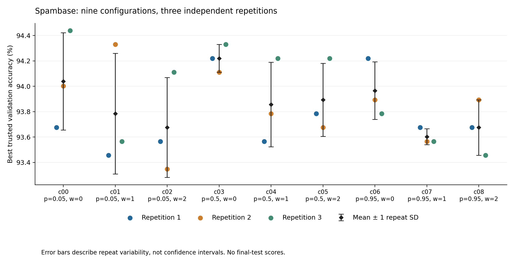

# Spambase 两维重复性校准结果

**本轮未达到预设的配置稳定性门槛。**

本轮只检验交叉概率与成绩权重能否在固定内层搜索中产生可重复的验证表现差异。没有运行外层 iStratDE，也没有新增最终测试评测。

共核验 27/27 次独立搜索；用量为 166 次模型请求、371,394 tokens，耗时 87.82 分钟。批准上限为 216 次请求、600,000 tokens、4 小时。
候选作业提交 165 次，成功评分 162 次，执行失败 3 次；失败请求的费用也计入用量。另有 1 次固定隔离探针，模型请求为 0，不计入实验样本。

另有 1 个候选因 Python 语法无效未提交作业，其模型费用同样计入上述请求及 tokens。

## 预先规定的稳定性判断

- 去除重复批次整体偏移后的估计配置方差占比：**0.0840**；门槛为 ≥ 0.5。
- 三个重复批次两两配置排名的 Spearman 相关系数中位数：**0.1266**；门槛为 ≥ 0.5。
- 必须完成全部九配置 × 三重复，并同时达到两个门槛；缺失值不填补，不追加试验。

这里的方差占比是本设计下的探索性描述量，草案将其称为估计 ICC。它不是总体参数或显著性检验；三次重复不足以证明某配置普遍更优。

## 九组配置

其余参数固定：进步权重 0.4、新颖性权重 0.25、调试深度 1。每次搜索三代、每代两个主候选，最多两次调试请求。中心配置 c04 为交叉概率 0.5、成绩权重 1。

| 配置 | 交叉概率 | 成绩权重 | 有效重复 | 平均最佳验证准确率 | 重复标准差（百分点） | 相对中心的平均配对差（百分点） |
|---|---:|---:|---:|---:|---:|---:|
| c00 | 0.05 | 0 | 3/3 | 94.039% | 0.383 | +0.182 |
| c01 | 0.05 | 1 | 3/3 | 93.784% | 0.475 | -0.073 |
| c02 | 0.05 | 2 | 3/3 | 93.675% | 0.393 | -0.182 |
| c03 | 0.5 | 0 | 3/3 | 94.220% | 0.109 | +0.363 |
| c04 | 0.5 | 1 | 3/3 | 93.857% | 0.333 | +0.000 |
| c05 | 0.5 | 2 | 3/3 | 93.893% | 0.289 | +0.036 |
| c06 | 0.95 | 0 | 3/3 | 93.966% | 0.227 | +0.109 |
| c07 | 0.95 | 1 | 3/3 | 93.602% | 0.063 | -0.254 |
| c08 | 0.95 | 2 | 3/3 | 93.675% | 0.218 | -0.182 |

彩色点为单次搜索最佳可信验证准确率；黑色标记为均值，误差线为重复标准差，并非置信区间。

## 实际搜索行为

交叉概率确实改变了操作选择。实际交叉次数／交叉或改进操作总次数为：p=0.05 时 2/36、p=0.5 时 18/36、p=0.95 时 33/36。
22/27 次搜索的后续候选超过初始两份草稿的最佳验证分数；100/108 次父代选择中成绩分量有区分度。以上均为已记录轨迹的描述，未与同预算纯草稿生成作因果对照。

## 核验与研究边界

每次收录结果均重新核对请求与账本、操作参数、候选源码、后台预测快照和验证答案哈希；共独立复算 162 份可信验证预测。完整矩阵的方差分解另以最小二乘投影复算，排名相关另以 SciPy 复算。
原比较实验的 6,413 个文件、历史账本和最终评测补齐阶段保持不变；本轮结束后确认栈空闲。未知用量请求数：0。全部请求均有提供方用量回报，没有未结算请求。

重复批次内共用搜索随机种子，九组配置的执行顺序预先随机化；模型输出仍有随机性。结果条件于这一份固定训练／验证拆分、该模型服务和当前短搜索设置。排名稳定性不是外层优化器优越性，也不是独立泛化证明。

- [逐次结果与成本](trials-27.csv)
- [操作与父代选择敏感性](operator-behavior.csv)
- [机器报告及独立复算](report.json)
- [已选协议](protocol.json)、[冻结顺序](schedule.json)

顺序文件保留了生成草案时的准备状态标记；本轮实际授权由独立私有凭证绑定实验清单，不能从公开顺序文件推断新的执行授权。

父代敏感性仅在实际记录的候选池上改变成绩权重，复算首个父代抽样概率；不代表新配置会产生多少准确率提升。原始模型消息、候选程序、预测行、账本及授权凭证保留在私有运行目录，不随报告发布。

执行源码：`64adefe6a267cfdac8ace7889ce7f70fefa594d2`；实验清单标识：`75131605f2f045be20dbdfa437960f7784bfeee9fe4d6f984043d4e458298753`。
