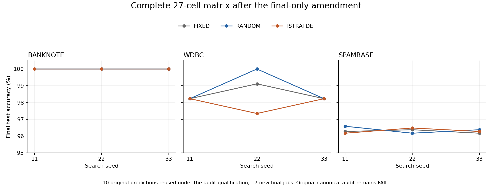
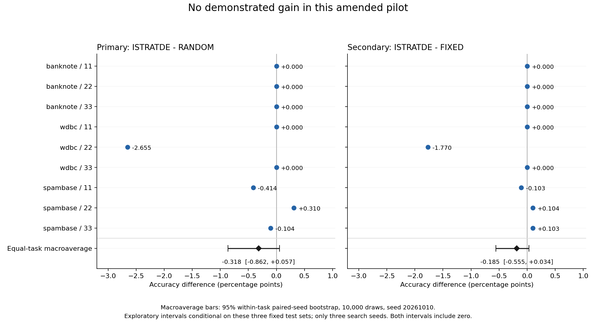
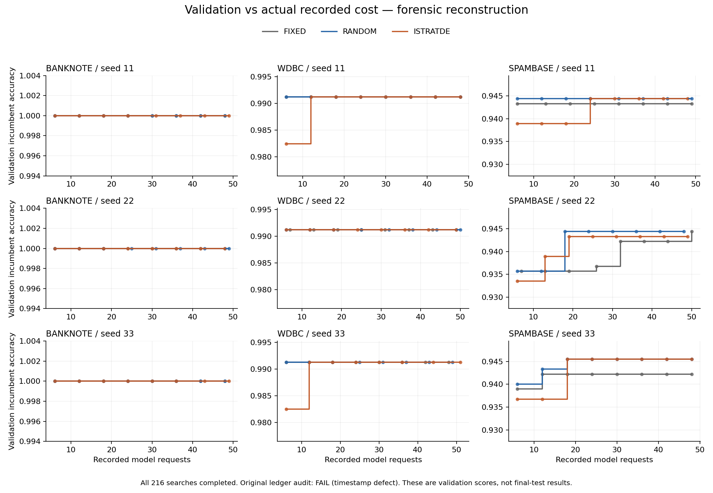
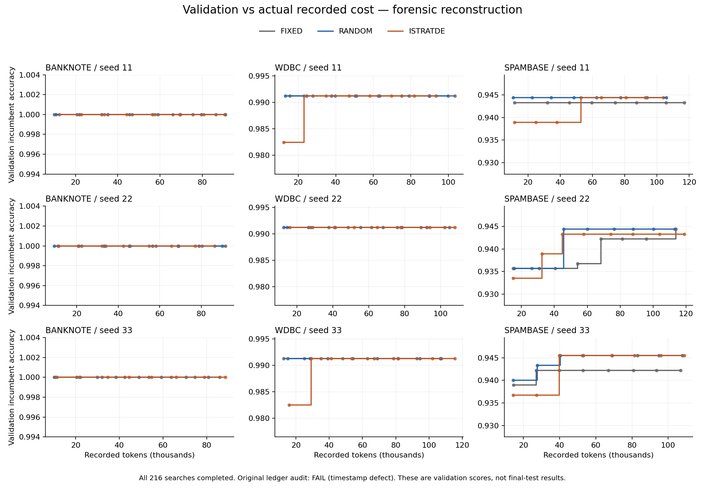

# iStratDE 先导实验：补齐后的结果未显示增益

用户另行授权的最终评测补齐阶段已经完成。沿用原冻结程序与数据，复用经补充审计核验的 10 份预测，新增 17 次最终评测，形成完整 27 单元矩阵。**iStratDE 未显示优于随机搜索或固定配置的证据。**

这是带明确协议修订和审计限定的探索性结果：原实验严格审计仍为 FAIL，原始记录没有改写。修订原因、限定时间戳例外及用户随后授权的独立阶段均随报告保留。

## 最终测试准确率

各任务先对三个搜索种子取平均，再对三个任务等权平均；没有按测试集大小加权。

| 任务 | 固定配置 | 随机搜索 | iStratDE |
|---|---:|---:|---:|
| banknote | 100.000% | 100.000% | 100.000% |
| wdbc | 98.525% | 98.820% | 97.935% |
| spambase | 96.273% | 96.377% | 96.308% |
| 三任务等权平均 | 98.266% | 98.399% | 98.081% |

| 配对比较 | 平均差（百分点） | 95% 探索性区间（百分点） |
|---|---:|---:|
| iStratDE − 随机搜索（主要） | -0.3180 | [-0.8620, +0.0575] |
| iStratDE − 固定配置（辅助） | -0.1852 | [-0.5555, +0.0345] |

两项区间均包含 0。主要比较的点估计为负，但这既不能证明 iStratDE 普遍更差，也不能证明方法完全等效；本轮只支持“没有观察到可靠增益”。区间条件于这三份固定测试集，仅有三个搜索种子，证据强度有限。

差异主要来自 WDBC 的种子 22：随机搜索为 100%，固定配置为 99.115%，iStratDE 为 97.345%。其余两个 WDBC 种子打平。Banknote 全部达到 100%；Spambase 的方法差异很小且方向不一致。没有依据这些测试结果继续改程序、换拆分或追加搜索。

## 本次补齐阶段

- 新最终作业：17 / 17 完成，全部成功评分且清理证据成立；没有重试或重复提交。
- 复用原预测：10 份，全部再次核对原后台记录及实际预测、源码、答案和来源政策。
- 新模型请求及 tokens：**0 / 0**。原搜索累计仍为 1,312 次请求 / 2,728,412 tokens。
- 阶段运行耗时：151.54 秒；批准的上限为 4 小时、17 次提交、每作业 600 秒。
- 独立复算：27 / 27 CSV、ID 集合、正确数、答案哈希、冻结代码字节、实际执行来源及清理证据通过。
- 原实验的 6,413 个文件审计前后不变，原停止账本没有恢复、延期或重写。
- 实际执行代码提交：`abe8141be431600fbd5f5a8e67f5eff7a3444272`；原候选生成源码仍为 `87569545793c141e393e72450094975733a2bb95`。

独立阶段用新的追加式事件目录和固定截止时间；排他创建的启动标记与每单元意图拒绝重复启动和重提。运行前的 12 项离线检查及类型检查通过，新栈镜像/挂载和空闲状态通过。仅使用 6581 隔离栈。

## 评分与统计口径

沿用可信评测器的六位小数准确率作为 raw accuracy 与 utility，另存精确正确数/测试行数及全精度准确率。修复后的核验将独立复算值舍入至六位，与后台评分比较，容差 1e-9；不放宽代码、预测、答案、来源或清理检查。

主要比较为 ISTRATDE−RANDOM，辅助比较为 ISTRATDE−FIXED；同任务同搜索种子配对，任务等权。按预先固定 RNG 20261010，在各任务内独立有放回重采样三个配对种子，重复 10,000 次，取线性插值百分位 95% 区间。另一个独立实现对两项点估计和区间逐项复核一致。27 个最终程序均成功，本次全量效用与成功单元准确率一致，无需填补失败或缺失值。

## 成本与验证曲线

原搜索每种方法均有 432 次主请求。FIXED 总请求 436 / tokens 914,574；RANDOM 437 / 900,041；ISTRATDE 439 / 913,797。原搜索中 17 次执行失败的费用已纳入统计；补齐阶段新增的 17 次最终作业不调用模型。

这两张是原搜索的验证曲线，不能当作最终测试结果，也没有用最终测试反馈继续搜索。

## 交付与审计边界

- [27 单元完整最终表](results-27-cells.csv)、[机器报告及独立复算记录](report.json)。
- [原搜索成本表](search-costs-27-cells.csv)、[逐配置成本曲线数据](validation-cost-curves.csv)。
- [原严格审计 FAIL](provenance/original-canonical-FAIL.json)、[补充审计](provenance/supplemental-audit.json)、[逐事件预算重放](provenance/original-budget-event-replay.json)。
- 本次用户授权凭证保留在本地；公开的是[独立阶段启动上限](stage/launch.json)、[阶段结果](stage/outcome.json)、[运行前栈检查](stage/preflight.json)。
- `frozen/` 保留原协议、实验清单和数据来源/拆分；`tools/` 保留本次独立报告与绘图脚本；`export-manifest.json` 记录原件与脱敏导出件哈希。

本报告完整的是**修订后的最终结果矩阵**，并非原协议的严格验收被改成通过。时间戳例外属于回溯性审计限定，补齐属于另行授权的新阶段；数据隔离判断基于冻结源码、预检探针、持久化哈希与时间顺序，没有完整的历史逐系统调用轨迹。这些限制应随任何引用一并保留。
