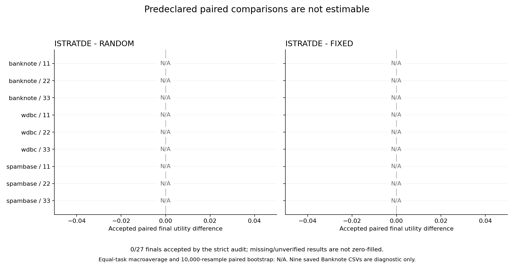

# iStratDE 先导对照实验：证据不足

本轮完成一次真实实验和全部 216 次内层搜索，但最终评测因实现缺陷停止，未形成可信的完整 27 单元测试比较。**不能据此宣称 iStratDE 有收益，也不能宣称没有收益。严格审计结果为 FAIL。**

执行源码提交：`87569545793c141e393e72450094975733a2bb95`。本报告保留该次执行及原审计；停止后的代码修复只面向未来运行，不改变本轮结论，没有追加模型请求、补跑最终评测或更换数据。

## 结果范围

| 项目 | 实际结果 |
|---|---:|
| 搜索单元完成 | 27 / 27 |
| 内层配置完成 | 216 / 216 |
| 主候选请求 | 1,296 / 1,296 计划机会 |
| 最终评测提交意图 | 10 / 27 |
| 已保存最终结果 | 9 / 27 |
| 通过完整严格审计的最终结果 | 0 / 27 |
| 已保存最终 CSV 独立算术复核 | 9 / 9 |
| 未尝试最终评测 | 17 |

九份已保存结果均为 Banknote（三种方法 × 三个种子），按原 CSV 和可信答案独立复算均为 276/276 = 1.0。预测、答案、冻结程序哈希以及保存的来源和清理事实均匹配。这些数值仅作为诊断性观察列入表格，**不被升级为通过完整审计的结果**。仅就这九份文件的算术值，两项方法差均为零；不能外推到完整三任务实验。

第十次最终作业为 WDBC / 11 / FIXED。原预测为 111/113 = 0.9823008849557522，后台原评分为 0.982301。程序执行成功且清理已证实，但完整性检查拒绝接受该分数，因此正式 raw accuracy 和 utility 仍为 null。其余 17 个单元未尝试最终评测。基础设施完整性错误和未观察值不属于已确认的候选失败，不能擅自补零。

## 两个导致本轮失败的实现缺陷

1. **最终阶段账本时间戳不一致。** 写入状态和事件时分别读取时钟，两值相差 4.52995300293e-06 秒。严格读取器要求二者完全一致，因而报 `corrupt_ledger:final_phase`。原始字节保持原样，未归一化或绕过验证。
2. **可信评分与复算精度不一致。** 可信评测器输出六位小数，最终核验却把它与未舍入准确率按 1e-9 比较。WDBC 的误差为 1.15044247795e-07，触发 `final_score_recompute_mismatch:wdbc:11:FIXED`。只读后台回执及预测/答案/源码哈希排除了 ID 对齐或文件混用解释。

原实验退出码为 2，没有触及硬预算或 24 小时限额，也没有自动恢复。停止后的回归测试使用合成数据：递增时钟检验真实写入/重新读取，113 条标签配合真实可信 metric 检验最终接受及只读恢复。代码修复的验证记录另附；它们不追认原实验为成功。

## 实际成本与失败

费用从原始账本的 1,312 条唯一请求独立重数，并逐条匹配预留和结算事件，再与 216 个哈希绑定的配置结果核对。该核算范围有限，不能取代失败的完整账本审计。

| 方法 | 主请求 | 调试 | 总请求 | tokens | 搜索执行失败 |
|---|---:|---:|---:|---:|---:|
| FIXED | 432 | 4 | 436 | 914,574 | 4 |
| RANDOM | 432 | 5 | 437 | 900,041 | 5 |
| ISTRATDE | 432 | 7 | 439 | 913,797 | 8 |
| 合计 | 1,296 | 16 | 1,312 | 2,728,412 | 17 |

输入 tokens 1,718,579，输出 tokens 1,009,833；未知用量 0，未结算预留 0。各单元均未超过 64 请求 / 200,000 tokens，全局未超过 1,728 请求 / 5,400,000 tokens。没有跨单元借额度或模型结果复用。

搜索作业提交 1,312 次，执行及清理记录核对 1,312 次，其中成功评分 1,295 次、执行失败 17 次（约 1.30%）；评分失败、准入拒绝、独立 timeout/cancelled 分类均为 0。调试和失败消耗已包括在上表。这里的状态分类按保存的作业证据计算，不把慢作业自行归类为超时。所有模型生成均发生在最终阶段之前。

监督进程 UTC 开始 `2026-10-11T07:04:55.701878+00:00`，结束 `2026-10-11T18:02:36.512733+00:00`。UTC 墙钟差 39460.811 秒（约 10 小时 57 分 41 秒），单调时钟耗时 37510.955 秒（约 10 小时 25 分 11 秒）；两者差异原因未确定，因此分别保留。216 个配置从启动意图至完成的墙钟累计 38561.494 秒，包含模型等待、启动与 sandbox 执行，不能解释为纯 GPU 计算时间。未估算美元费用。

## 比较、曲线与统计限制

预注册主要比较为 ISTRATDE−RANDOM，辅助比较为 ISTRATDE−FIXED。完整的九个任务/种子配对、等权三任务宏平均和 10,000 次任务内配对种子 bootstrap 均为 **N/A**，原因是缺少通过完整审计的最终矩阵。没有将未完成或未验证的结果补零，也没有用验证准确率替代最终准确率。

即便矩阵完整，三个搜索种子的区间也只是条件于这三份固定测试集的探索性证据。此处不生成误导性的零宽区间或显著性结论。

以下曲线来自独立重数的实际请求与 tokens，展示每完成一组配置后的**验证集**最佳分数；不含任何最终测试反馈。

原 CLI 图表保留在 `canonical/plots/` 作为审计快照。其账本加载失败后成本轴退回零值，**不得解释为零成本实验或用于比较**；应使用上面的取证重建曲线。原报告与补充报告的区别明确保留。

## 核验与交付文件

- [27 单元完整表](forensic/results-27-cells.csv)：验证分数、正式最终空值、诊断性算术值、费用及失败分列。
- [独立核算与证据哈希](forensic/forensic-summary.json)、[逐配置成本曲线数据](forensic/validation-cost-curves.csv)、[最终 CSV 复核](forensic/final-recompute.csv)。
- [WDBC 原后台作业回执](forensic/wdbc-original-job-receipt.json)：只读获取，已移除日志、凭据和内部作业路径。
- [原严格审计 FAIL](canonical/audit.json)、[原机器报告](canonical/report.json)、[原报告文本](canonical/report.md)。
- [冻结协议](frozen/protocol.md)、[冻结实验清单](frozen/experiment-manifest.v1.json)、[数据来源与拆分清单](frozen/data-manifest.v1.json)、[最终预检](frozen/preflight.json)。
- `frozen/source/` 保存本轮实际执行的两个缺陷模块；`tools/` 保存补充核算与绘图脚本。`export-manifest.json` 记录原文件与脱敏导出文件各自 SHA-256。

原生算法状态、全部配置向量、源码冻结和清单绑定已由原 CLI 离线加载复核；预检和先前监督记录覆盖搜索阶段数据隔离、重复组拆分、配额和模型参数一致性。最终阶段的账本/发布链核验失败，不能将这些局部通过合并成整体通过。旧 6580 栈及两轮旧验收账本保持不变，旧账本哈希已再次核对。本轮结果不足以回答增益问题，但按预先约定，可信地报告这一不足即为本轮研究交付；不追加实验追求正结果。

## 停止后的代码验证

两个确定性回归在修复前均重现故障，修复后连同相关测试共 72 项通过；项目类型检查覆盖 169 个文件通过。旧两轮验收 164 份证据复核通过。六张图已检查，主文使用的三张补充图可读；原 CLI 成本图的限制已单独说明。详见 [离线验证记录](offline-verification.json)。这些检查不改变本轮审计 FAIL 或证据不足结论。
