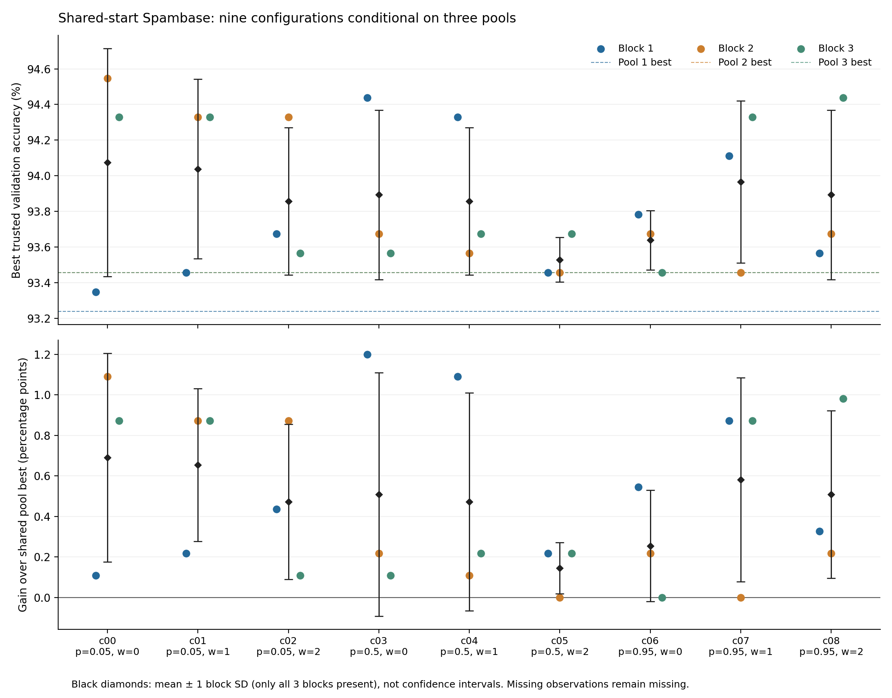
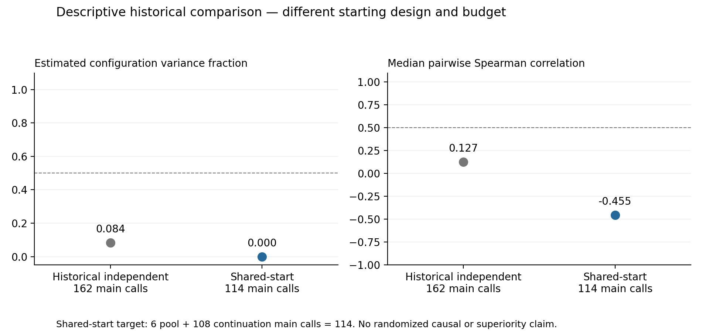

# Spambase 共享初始候选池实验

**本轮没有达到预设的稳定性门槛。**

已独立核验 30/30 个单元；完成 3/3 个初始候选池、27/27 次续跑。全轮费用为 115 次请求、291,975 tokens，耗时 90.78 分钟。上限为 174 次请求、600,000 tokens、4 小时。

初始池费用共 6 次请求、8,331 tokens，仅记一次；27 次续跑合计 109 次请求、283,644 tokens。失败、调试和未通过验证单元的已记账费用都包含在总额中。用量状态：已知 115，未知 0，尚未结算 0。后两类按完整预留额度计费，并非已确认实际消耗。

每个批次先生成两份有效终端候选，必要时在预算内调试；同批九个配置导入同一份已封存候选池。每次续跑只新增四次主请求，最多两次调试。首次父代选择必须实际包含这两个共享候选，不能仅在日志中保留它们。后续原生错误恢复可以生成新 draft，仍占用四次主请求额度。

## 稳定性判断

- 去除批次整体偏移后的估计配置方差占比：**0.0000**；门槛 ≥ 0.5。
- 批次间配置排名 Spearman 相关中位数：**-0.4550**；门槛 ≥ 0.5。
- 只有三个池及全部 27 次续跑完整且证据有效，并同时达到两个门槛，才记为观察到探索性稳定信号。缺失值不填补，不删除失败单元，不追加试验。

三个批次的两两排名相关：-0.4550、-0.4679、0.0439。
两个批次取平均后，与留出批次的排名相关依次为：-0.5190、-0.2112、-0.3305。这里留出的是重复批次，所有评分仍使用同一验证集。
完整矩阵已另用最小二乘投影复算方差分解、SciPy 复算排名相关，与冻结分析器一致。

本轮配置均方小于剩余均方，冻结估计规则将配置方差截断为 0。这是三个批次的样本估计，不能据此证明真实配置效应为零。

## 九个配置与共同起点

| 配置 | 交叉概率 | 成绩权重 | 完成批次 | 平均最佳验证准确率 | 批次标准差（百分点） |
|---|---:|---:|---:|---:|---:|
| c00 | 0.05 | 0 | 3/3 | 94.075% | 0.639 |
| c01 | 0.05 | 1 | 3/3 | 94.038% | 0.504 |
| c02 | 0.05 | 2 | 3/3 | 93.857% | 0.413 |
| c03 | 0.5 | 0 | 3/3 | 93.893% | 0.475 |
| c04 | 0.5 | 1 | 3/3 | 93.857% | 0.413 |
| c05 | 0.5 | 2 | 3/3 | 93.530% | 0.126 |
| c06 | 0.95 | 0 | 3/3 | 93.639% | 0.167 |
| c07 | 0.95 | 1 | 3/3 | 93.966% | 0.454 |
| c08 | 0.95 | 2 | 3/3 | 93.893% | 0.475 |

三个共享池的最佳验证准确率依次为：93.2388%、93.4569%、93.4569%。相同基线的虚线会重叠。

彩色点是各批次观察值，虚线为该批共享池最佳分数；黑色标记及误差线仅在三个批次齐全时绘制，表示均值±批次标准差，不是置信区间。下图显示相对各自共享池的增益。表中的未完整配置均值只描述现有观察，不用于完整矩阵判定。

有 24/27 次续跑超过共享池最佳分数；3 次最终仍选择导入候选。已核验续跑中共有 0 次新增 fallback draft。

按操作轨迹中的新节点 ID 去重，共核验 115 个新节点，其中 1 个标记为失败、0 个因无效 Python 被拒绝。导入节点未重复计入。行为及失败节点统计仅覆盖独立核验单元；费用覆盖所有单元。

## 与上一轮的描述性比较

上一轮独立起点校准的配置方差占比为 0.0840，排名相关中位数为 0.1266；本轮分别为 0.0000、-0.4550。

两轮的估计对象不同：本轮比较的是给定同一初始池后的条件续跑表现，三个池才是独立的起点；上一轮每次搜索各自产生初始草稿。本轮完整设计只需 114 次主请求（6 次建池＋108 次续跑），上一轮为 162 次。起点、总预算和执行时段同时不同，因此这些数值不能证明共享起点导致稳定性改善，也不能证明某配置或外层算法更优。三批次规模较小，结果还条件于固定数据拆分、模型服务和短搜索预算。

## 证据与边界

重新核对了全部已收录单元的账本、来源代码、预测快照、验证答案哈希和操作选择概率。独立复算 114 份唯一新作业预测；另外 27 次共享池导入审计不计为新作业或新费用。

原比较实验 6,413 个文件、上一轮校准 831 个文件、历史账本及最终评测阶段均与启动前哈希一致。当前运行目录在报告读取前后哈希不变。结束时栈空闲证据：True。另有 1 次固定隔离探针，模型请求为零，不是测量样本。新增最终测试评测为 0；没有运行外层 iStratDE。

全部 30 个单元均完成，没有删除或填补观察。

- [全部 30 单元与成本](units-30.csv)
- [27 次续跑](continuations-27.csv)、[3 个初始池](pools-3.csv)
- [操作行为](operator-behavior.csv)、[机器报告](report.json)
- [冻结协议](protocol.json)、[冻结顺序](schedule.json)

原始候选程序、模型消息、预测行、账本及授权凭证均保留在私有运行目录。公开报告只含聚合统计、配置及证据哈希。冻结计划中的草案状态文字不代表新的执行授权。

执行源码：`b1e3245796122845286a33c41172d9a92b987f6d`；实验清单：`a4514cc0d98ff854b618809361cc730d86be12d7d1d73e0e3863fc3d8a13618e`。
